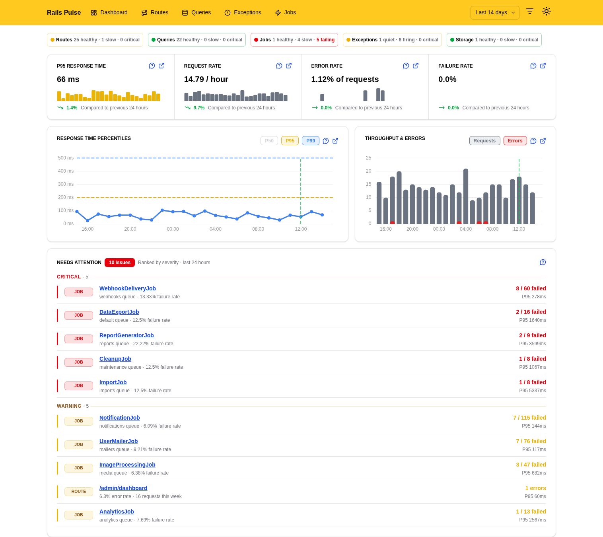
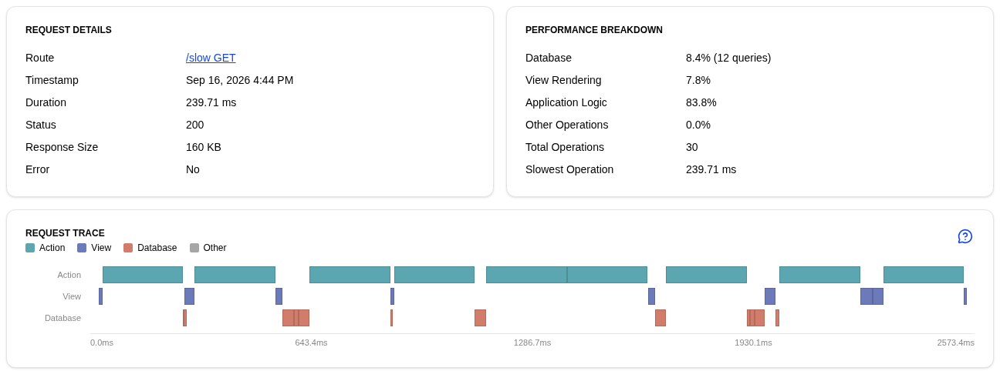
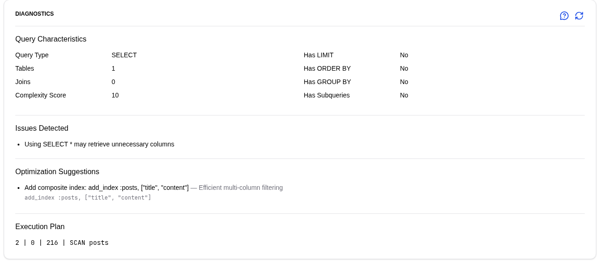
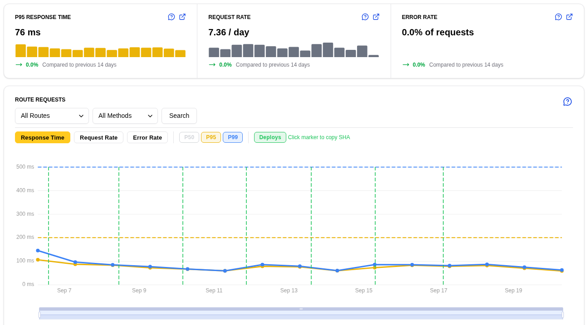

<div align="center">
  
</div>

# Rails Pulse

**Performance monitoring that lives inside your Rails app.** Slow requests, N+1 queries, background jobs and exceptions, stored in your own database. No agent, no account, no data leaving your servers.


Rails Pulse is a Rails engine. It hooks into the instrumentation Rails already emits, writes what it sees to a handful of tables, and mounts a dashboard that shows you where the time went. Install the gem, run one migration, schedule two jobs, and you have monitoring that works the same on SQLite, PostgreSQL and MySQL.


<picture>
  <source media="(prefers-color-scheme: dark)" srcset=".github/images/dashboard-dark.png">
  
</picture>

## What you get

- **The state of the app in one screen.** A health bar counts healthy, slow and critical routes, queries, jobs and exception groups. A ranked "needs attention" list tells you what to fix first.
- **Every request, broken down.** Each request stores its route, status, duration and a timeline of the SQL, view, cache, HTTP, mailer and Active Storage operations inside it.
- **Queries you can act on.** SQL is normalised and fingerprinted, so you see execution counts and P95 per statement shape, N+1 patterns, an EXPLAIN plan and index suggestions.
- **Jobs and exceptions in the same place.** Duration, queue wait and failure rate for every Active Job class on any adapter. Unhandled exceptions from requests and jobs grouped by class and location, with filtered params and backtraces.
- **Numbers over time.** Hourly, daily, weekly and monthly summaries with P50, P95 and P99, your service level objectives drawn as lines on the charts, and a marker for every deploy so a regression lines up with the release that caused it.
- **Built for production.** Tracking is queued off the request thread and dropped rather than blocked under load. If the gem is deployed before its migrations, tracking pauses and tells you what to run. Retention is enforced by age and by row count so the tables never grow without bound.
- **Your coding agent can read it.** A read-only JSON API, a `rails-pulse` CLI and an MCP server give Claude Code, Codex, Cursor or a CI script the same data: the slowest endpoints since the last deploy, the queries behind them, the jobs that failed. Ask the agent why checkout got slow and it can go and look.

<table>
  <tr>
    <td width="50%" valign="top">
      <picture>
        <source media="(prefers-color-scheme: dark)" srcset=".github/images/request-dark.png">
        
      </picture>
      <p align="center"><sub>A request and where its time went</sub></p>
    </td>
    <td width="50%" valign="top">
      <picture>
        <source media="(prefers-color-scheme: dark)" srcset=".github/images/query-dark.png">
        
      </picture>
      <p align="center"><sub>Diagnostics and an index suggestion for one query</sub></p>
    </td>
  </tr>
  <tr>
    <td colspan="2">
      <picture>
        <source media="(prefers-color-scheme: dark)" srcset=".github/images/route-dark.png">
        
      </picture>
      <p align="center"><sub>One route over two weeks, with objective lines and deploy markers</sub></p>
    </td>
  </tr>
</table>

## Quick start

```ruby
# Gemfile
gem "rails_pulse"
```

```bash
bundle install
rails generate rails_pulse:install
rails db:migrate
```

```ruby
# config/routes.rb
mount RailsPulse::Engine => "/rails_pulse"
```

Schedule the summary job hourly and the cleanup job daily with whatever your queue adapter provides. With Solid Queue:

```yaml
# config/recurring.yml
production:
  rails_pulse_summary:
    class: RailsPulse::SummaryJob
    schedule: "5 * * * *"
  rails_pulse_cleanup:
    class: RailsPulse::CleanupJob
    schedule: "0 1 * * *"
```

Open `http://localhost:3000/rails_pulse`. That's the whole setup.

Requirements: Ruby 3.2+, Rails 7.2+ (tested on 7.2, 8.0 and 8.1), SQLite, PostgreSQL or MySQL.

Full install guide, including a separate database and plain cron: [railspulse.com/documentation/installation](https://railspulse.com/documentation/installation)

## Going further

**Lock it down.** The dashboard is authenticated by default outside development and test. Point it at your own auth with a predicate; anything but `true` is a 403.

```ruby
RailsPulse.configure do |config|
  config.authorize = ->(controller) { controller.current_user&.admin? }
end
```

With nothing configured it falls back to HTTP Basic against `RAILS_PULSE_USERNAME` and `RAILS_PULSE_PASSWORD`. [Authentication guide](https://railspulse.com/documentation/authentication)

**Tune it.** Thresholds for slow, very slow and critical, service level objectives per percentile, what to ignore, what to tag, how long to keep. All in `config/initializers/rails_pulse.rb`. [Configuration reference](https://railspulse.com/documentation/advanced)

**Run the dashboard on its own.** `bundle exec rails_pulse_server` serves the UI from a separate process with its own health endpoint, so a slow report never competes with your app for a thread. [Deployment modes](https://railspulse.com/documentation/deployment-modes)

**Mark your deploys.** `rails rails_pulse:record_deployment[sha]` from a release script, or `POST /rails_pulse/deployments` with the API token from CI, and every chart draws a line at that moment.

**Brief your agent.** Set `config.api_token`, then on your machine:

```bash
rails-pulse configure          # URL and token, saved to ~/.rails-pulse
rails-pulse routes list --since 2026-06-01T00:00:00Z
rails-pulse install claude     # Claude Code skill: when and how to use the tools
```

Add `gem "mcp"` to your Gemfile (a development group is enough), register `rails-pulse mcp` as an MCP server, and the agent gets eleven read-only tools: routes, slow requests, errors, exception groups and their backtraces, one endpoint in depth, expensive and N+1 queries, job health, deployments and whether each one made things worse, what needs attention and whether your thresholds fit, and what has actually been recorded. Nothing the agent can call changes production. [Agent tooling](docs/api.md)

**Keep it in its own database.** `rails generate rails_pulse:install --database=separate` puts the tables somewhere your primary never has to vacuum. [Database setup](https://railspulse.com/documentation/database)

## Remote and central modes

This fork adds two modes for running one Rails Pulse for several applications. They exist for apps that cannot share a database: each app on SQLite in its own container, say, with a volume no other container can read.

- **Remote mode**, on each monitored application: Rails Pulse collects exactly as it always does, but writes nothing to the application's database. What it collects (requests and their operations, job runs, exceptions, the writer's heartbeat, deploy markers) is sent in gzipped JSON batches over HTTPS to a central Rails Pulse. The application needs no Rails Pulse tables and no migration.
- **Central mode**, on one Rails app of its own: it receives the batches, authenticates each by its token, and writes every application into a database of its own (a shard of `RailsPulse::ApplicationRecord`), through the same models and persistence code a single install uses. It runs `SummaryJob` and `CleanupJob` for every application and serves one dashboard per application at `/<name>/`, plus an index of them at `/`.

Neither mode changes anything until it is configured. Remote mode excludes central mode and Rails Pulse Cloud; central mode excludes `config.connects_to` and Cloud. Configuration that fails these checks raises at boot.

### On each application (remote mode)

```ruby
# Gemfile
gem "rails_pulse", github: "virtual360-io/rails_pulse", branch: "remote-mode"
```

Remote mode is on when both settings are present. Each defaults to its environment variable, read when first needed, so the deploy can turn it on without touching the initializer:

```bash
RAILS_PULSE_REMOTE_URL=https://pulse.example.com    # the central's base URL; a path prefix is kept
RAILS_PULSE_REMOTE_TOKEN=<this application's token on the central>
```

```ruby
# config/initializers/rails_pulse.rb: optional, the defaults read the variables above
RailsPulse.configure do |config|
  config.remote.url = ENV["RAILS_PULSE_REMOTE_URL"]
  config.remote.token = ENV["RAILS_PULSE_REMOTE_TOKEN"]

  # Collection settings stay here and apply before anything is sent:
  config.track_jobs = true
  config.track_exceptions = true
end
```

Keep the engine mounted if it is; in remote mode its pages and JSON API answer `404` (the API still checks its token first). Do not schedule `SummaryJob` or `CleanupJob` here: in remote mode they do nothing. `rails rails_pulse:status` reports where the data goes. The deploy markers still come from the same tasks, which now send to the central and fail when it does not record them:

```bash
bin/rails rails_pulse:record_deployment[$GIT_SHA]
bin/rails rails_pulse:finish_deployment[$GIT_SHA]   # append "|| true" if a central outage must not fail the deploy
```

How sending behaves:

- Requests, job runs and exceptions go on the writer's queue (`config.async_queue_size`, default 1,000) and are posted by the writer thread, one batch per drain of up to 50 items. Nothing is sent from a request or job thread, and a full queue drops the newest item, counted, as it always has. With `config.async = false` each item is sent inline instead.
- Timeouts are 2 seconds to connect and 5 to answer. After a failure nothing is sent until a backoff has passed (5 seconds, doubling, up to 5 minutes, with jitter), and batches wait in memory meanwhile: at most 100 batches or 10 MB, oldest dropped first, each tried at most 10 times. A refused token (`401`, `403`, `404`) waits 5 minutes. Drops are logged at most once a minute and reported with the next writer heartbeat, which the central's Tracking badge adds up.
- Each process sends its own: forked Puma workers and job processes each start their own writer and queue, and a forked child never resends its parent's batches. At exit the writer's hook drains its queue and sends what the backoff allows; batches still held after that are lost.
- Nothing raises to the host and no Rails Pulse table is touched: the schema check is off, and the dashboard, jobs and Cloud sync stand down.
- What leaves the application is what a single install would store, except that SQL operations carry the statement as it ran (`actual_sql`, values included) so the central can normalise and fingerprint it; the central stores it only with its own `config.capture_actual_sql`. Exception messages and request params are redacted here, with this application's `filter_parameters` and `exception_message_filter`, before anything is sent.

### On the central (central mode)

The central is its own Rails app with the same gem. List each application with its token and the `config/database.yml` entry its data goes to:

```ruby
# config/initializers/rails_pulse.rb (start from `bin/rails generate rails_pulse:install --database=separate`)
RailsPulse.configure do |config|
  config.central.applications = {
    vquick: { token: ENV["RAILS_PULSE_VQUICK_TOKEN"], database: :pulse_vquick },
    aboard: { token: ENV["RAILS_PULSE_ABOARD_TOKEN"], database: :pulse_aboard },
    lina:   { token: ENV["RAILS_PULSE_LINA_TOKEN"],   database: :pulse_lina }
  }

  # Dashboard, storage and retention settings apply to every application:
  config.track_jobs = true          # draws the Jobs pages
  config.track_exceptions = true    # draws the Exceptions pages
  config.authorize = ->(controller) { controller.current_user&.admin? }
end
```

An application name is lowercase letters, digits, dashes and underscores; it becomes the path segment of its dashboard and the name of its shard. Each token must be at least 32 characters (`ruby -rsecurerandom -e 'puts SecureRandom.hex(32)'`) and unique. A missing token (`nil`, as during `assets:precompile`) boots, and that application accepts nothing until it has one.

One SQLite database per application, all sharing `db/rails_pulse_migrate`:

```yaml
# config/database.yml
production:
  primary:
    <<: *default
    database: storage/production.sqlite3
  # ...the app's own cache, queue and cable databases...
  pulse_vquick:
    <<: *default
    database: storage/production_pulse_vquick.sqlite3
    migrations_paths: db/rails_pulse_migrate
    schema_dump: false
  pulse_aboard:
    <<: *default
    database: storage/production_pulse_aboard.sqlite3
    migrations_paths: db/rails_pulse_migrate
    schema_dump: false
  pulse_lina:
    <<: *default
    database: storage/production_pulse_lina.sqlite3
    migrations_paths: db/rails_pulse_migrate
    schema_dump: false
```

Repeat the entries for development and test. Routes: the ingestion endpoint, the index, and the engine mounted under the application's name. The segment must be named `rails_pulse_application`, and the endpoint's path is fixed, because applications post to `<remote.url>/rails_pulse/v1/batches`:

```ruby
# config/routes.rb
Rails.application.routes.draw do
  post "/rails_pulse/v1/batches", to: "rails_pulse/central/batches#create"
  root to: "rails_pulse/central/applications#index"
  mount RailsPulse::Engine, at: "/:rails_pulse_application", as: :rails_pulse,
        constraints: RailsPulse::Central.route_constraints
end
```

`/vquick/` is then vquick's dashboard, read from vquick's database, and every link it generates stays under `/vquick`; the JSON API is at `/vquick/api/v1/...` (with `config.api_token`), and CI can also post deploy markers to `/vquick/deployments` (with `config.deployment_token`). The constraint lets only the configured names reach the engine, so the central's other routes, such as `/up`, stay its own. `authentication_method` and `authorize` guard every dashboard and the index; for per-application rules, `RailsPulse::Central.current_application` is the application being served (a symbol, `nil` on the index). The index lists each application and when it was last heard from, and `return_to_app_url` (default `/`) links the dashboards back to it.

Set it up in this order, so the generators see a central:

```bash
bin/rails generate rails_pulse:install --database=separate   # initializer, db/rails_pulse_schema.rb, db/rails_pulse_migrate/
# edit config/initializers/rails_pulse.rb, config/database.yml and config/routes.rb as above
# (the install generator's own next steps describe a single separate database; follow these instead)
bin/rails generate rails_pulse:upgrade                       # copies this version's migrations to db/rails_pulse_migrate
bin/rails db:prepare                                         # creates each database and loads the schema into it
bin/rails rails_pulse:status                                 # reports on each application in turn
```

On a central, `db:prepare` and `db:migrate` first load `db/rails_pulse_schema.rb` into any application database that does not have the tables yet, and record the migrations in `db/rails_pulse_migrate` as applied there; then Rails migrates every database as usual. So adding an application is a `central.applications` entry, a `database.yml` entry and its token, then `bin/rails db:prepare`, which a deploy that runs it on boot does by itself. To upgrade the gem: `bin/rails generate rails_pulse:upgrade` (it recognises a central and copies new migrations to `db/rails_pulse_migrate`), then `bin/rails db:migrate`, which runs them against every application's database.

Schedule the jobs as for a single install. Each runs once per application, in that application's database; one application's failure does not stop the others and is raised once they have run:

```yaml
# config/recurring.yml
production:
  rails_pulse_summary:
    class: RailsPulse::SummaryJob
    schedule: "5 * * * *"
  rails_pulse_cleanup:
    class: RailsPulse::CleanupJob
    schedule: "0 1 * * *"
```

The central tracks nothing of its own. Anything that reads Rails Pulse tables must run inside one application's database: `RailsPulse::Central.with_application(:vquick) { RailsPulse::Request.count }`. Outside one, `RailsPulse::ApplicationRecord` has no default shard and raises `ActiveRecord::ConnectionNotEstablished` rather than reading whichever application is listed first.

### The contract (version 1)

```
POST <remote.url>/rails_pulse/v1/batches
Authorization: Bearer <application token>
Content-Type: application/vnd.rails-pulse.batch+json
Content-Encoding: gzip
Rails-Pulse-Remote-Contract: 1
```

The token alone names the application: the central compares it, in constant time, with every configured token. The vendor content type keeps the central's Rails from parsing the gzipped body into params. A body without `Content-Encoding: gzip` is read as plain JSON. The body:

```json
{
  "version": 1,
  "batch_id": "0f8c2a9e-6b0d-4a51-9a2e-3d1f6c7b8e90",
  "created_at": "2026-11-12T20:00:00.123456Z",
  "hostname": "web-1",
  "pid": 4321,
  "environment": "production",
  "gem_version": "0.5.1.pre.3",
  "rails_version": "8.1.1",
  "ruby_version": "3.4.7",
  "items": [
    { "type": "request", "method": "GET", "path": "/posts/:id", "duration": 84.2, "status": 200,
      "controller_action": "posts#show", "occurred_at": "2026-11-12T19:59:58.402311Z",
      "is_error": false, "request_uuid": "c2f…", "response_size_bytes": 5120,
      "operations": [
        { "operation_type": "sql", "label": null, "actual_sql": "SELECT * FROM posts WHERE id = 1", "duration": 1.2,
          "codebase_location": "app/controllers/posts_controller.rb", "start_time": 1794167998.41,
          "occurred_at": "2026-11-12T19:59:58.410112Z", "row_count": 1 }
      ] },
    { "type": "job_run", "job_class": "ReportJob", "queue_name": "default", "run_id": "8d1…",
      "initial_status": "enqueued", "status": "failed", "enqueued_at": "…", "occurred_at": "…", "attempts": 1,
      "adapter": "solid_queue", "arguments": null, "duration": 950.0, "error_class": "Net::ReadTimeout",
      "error_message": "Net::ReadTimeout with #<TCPSocket:(closed)>", "operations": [] },
    { "type": "exception", "exception_class": "Net::ReadTimeout", "location": "app/jobs/report_job.rb#perform",
      "message": "…", "backtrace": [ { "file": "/rails/app/jobs/report_job.rb", "line": 12, "method": "perform" } ],
      "request_url": null, "request_method": null, "request_params": null, "environment": "production",
      "deploy_sha": null, "occurred_at": "…" },
    { "type": "writer_heartbeat", "hostname": "web-1", "pid": 4321, "host_label": null, "queue_size": 1000,
      "queue_depth": 0, "dropped": 0, "dropped_total": 0, "sampled_at": "…" },
    { "type": "deployment", "action": "record", "revision": "abc1234", "started_at": "…", "metadata": { "by": "ci" } },
    { "type": "deployment", "action": "finish", "revision": "abc1234", "finished_at": "…" }
  ]
}
```

Times are UTC ISO 8601 strings, with microseconds. Items carry what the collectors gather, field for field:

| Type | Required | Optional | Recorded by |
|---|---|---|---|
| `request` | `method`, `path`, `duration`, `status`, `occurred_at`, and `request_uuid` unless `detail` is `false` | `controller_action`, `is_error` (defaults to `status >= 500`), `response_size_bytes`, `detail`, `operations` | `Tracker.perform_tracking_batch`: route, request, operations, query fingerprints, N+1 marks; `"detail": false` (a request `store_full_details` folded) goes to the rollups instead, with SQL operations reduced to `operation_type`, `label`, `actual_sql` and `duration` |
| `job_run` | `job_class`, `run_id`, `initial_status`, `status` (both one of `enqueued running success failed discarded retried`), `occurred_at` | `queue_name`, `enqueued_at`, `attempts`, `adapter`, `arguments`, `duration`, `error_class`, `error_message`, `operations` | `JobRunCollector.record`: the job, the run as it started, its outcome, its operations |
| `exception` | `exception_class`, `location`, `occurred_at` | `message`, `backtrace` (up to 50 `{file, line, method}`), `request_url`, `request_method`, `request_params`, `environment`, `deploy_sha` | `ExceptionCaptureService.record`: the group by fingerprint (SHA-256 of class and location, computed by the central), the occurrence unless the group is ignored; a missing `deploy_sha` is the application's latest deployment |
| `writer_heartbeat` | `hostname`, `pid`, `queue_size`, `queue_depth`, `dropped`, `dropped_total`, `sampled_at` | `host_label` | `Tracker.record_heartbeat`, for the process it describes |
| `deployment` | `action` (`record` or `finish`), `revision`; `started_at` to record, `finished_at` to finish | `finished_at` and `metadata` to record | `Deployment.create!`, or the latest row for the revision `update!(finished_at:)` |

An operation carries `operation_type` (one of `sql controller template partial layout collection cache_read cache_write http job mailer storage`), `duration` and, outside a folded request, `occurred_at`; it may carry `label`, `actual_sql`, `codebase_location`, `start_time`, `row_count` and `cache_hit`. Every other key, an operation's own ids included, is dropped: nothing an application sends reaches a column the contract does not name.

Answers:

| Status | When | What the sender does |
|---|---|---|
| `202` | recorded; the body is `{ "batch_id", "accepted", "rejected", "errors", "duplicate" }` | done; `rejected` items are counted as dropped and their first errors logged |
| `400` | the body is not (gzipped) JSON | drops the batch |
| `401` | no token, or no application has it | keeps the batch, waits 5 minutes |
| `413` | the body is over 8 MB, compressed or not | splits the batch in halves |
| `422` | the envelope does not match: another `version`, no `batch_id`, `items` not an array or over 1,000 | drops the batch |
| `503` | the application's database is behind this gem or unreachable | keeps the batch, backs off |

An item that does not match is rejected on its own (`"items[3] (job_run): run_id is required"`) and the rest of the batch is still recorded; an unknown `type` is rejected the same way, so a newer sender degrades rather than fails. Delivery is at least once: a retried batch keeps its `batch_id`, and a `batch_id` the application's database has already recorded is answered `202` with `"duplicate": true` without being recorded again (each recorded batch leaves a `remote_batch` event, pruned after a day). A request item that cannot be written is logged on the central and still counted as accepted, as the writer does locally.

### Not supported

- Moving data between modes: switching an install to remote mode leaves its existing tables untouched and unread, and nothing imports them into the central.
- Rails Pulse Cloud with either mode, and `config.connects_to` on a central.
- Rake tasks other than `rails_pulse:status`, `db:prepare`, `db:migrate` and `db:schema:load_rails_pulse` on a central (`backfill_summaries`, `cleanup`, `cleanup_stats`, `migrate_routes`): run their code inside `RailsPulse::Central.with_application`.
- What needs the monitored application's code or database: the central has the application's Rails Pulse tables but not its router or its own tables, so routes are not backfilled (`migrate_routes`) and EXPLAIN plans cannot run (as with a separate Pulse database); SQL is normalised with the central's adapter rules, so applications on MySQL want a central on MySQL.
- Per-application settings on the central: thresholds, tags, SLOs, `capture_actual_sql` and retention come from the central's initializer, and summaries are cut in the central's time zone.
- Durable buffering: held batches live in the sending process's memory. A central outage longer than the buffer, or a restart while batches are held, loses that data, counted where it can be.
- Shards on PostgreSQL or MySQL: central mode is built and tested with one SQLite database per application.

## Upgrading

```bash
bundle update rails_pulse
rails generate rails_pulse:upgrade
rails db:migrate                  # separate Pulse database: rails db:migrate:rails_pulse
rails rails_pulse:status          # exits 1 while anything still needs action
```

Upgrading from 0.3.x to 0.4? **Back up first**, run `rails rails_pulse:migrate_routes` after migrating, and restart every process together. The details are in the [changelog](CHANGELOG.md).

## Contributing

Bug reports and pull requests are welcome on [GitHub](https://github.com/railspulse/rails_pulse). `docs/` explains how the pieces fit and why they are built the way they are. Building on top of Rails Pulse (a plugin, scripting the CLI)? [`docs/api.md`](docs/api.md) states what's public and stable across minor releases.

```bash
git config core.hooksPath .githooks   # once, after cloning
DB=sqlite3 rake test                  # or DB=postgresql / DB=mysql2
bundle exec rubocop
```

## License

Available as open source under the [MIT License](https://opensource.org/licenses/MIT).
